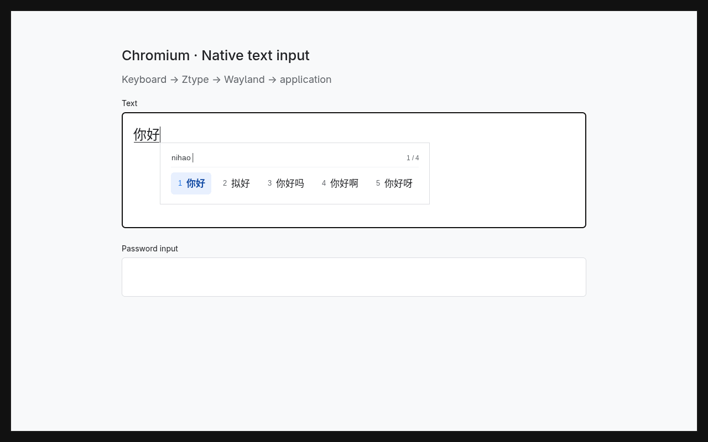

# ztype

[简体中文](README.zh-CN.md) · [0.4.1 installation and acceptance](docs/installed-native-0.4.1.zh-CN.md) · [Source license](LICENSE)

**Ztype 0.4.1 is a Linux input method built on Project Z, with native Wayland and X11/XWayland services.** It keeps composition in the focused application and shows a separate candidate popup without taking keyboard focus. The Google-inspired light popup uses a white surface, blue selection and generous spacing: the tested 1× layout is 112 px tall with 20 px padding.

Pinyin uses a local, separately installed vocabulary; kana and custom code tables are also supported. Fcitx and Rime services are not runtime requirements. The optional `panel` is a separate composition helper; daily native input runs through `wayland` or `x11`.



## Build and install

Use Rust 1.100 or newer and clone the pinned framework/UI submodules:

```sh
git clone --recurse-submodules --branch fix/wayland-focus-replay-20261120 https://github.com/LIghtJUNction/ztype.git
cd ztype
cargo build --release --locked

# Download and verify the pinned, separately licensed pinyin data.
python3 scripts/install_dictionary.py
python3 scripts/install.py --binary target/release/ztype

~/.local/bin/ztype features
~/.local/bin/ztype config
~/.local/bin/ztype wayland-doctor
~/.local/bin/ztype status
```

The full Linux build needs a C compiler, `pkg-config`, X11/OpenGL, FreeType/fontconfig, XCB with xcb-imdkit/Shape, and Wayland/XKB system libraries. See the [build features](Cargo.toml) for optional components. The scripts do not install these system packages.

The dictionary installer defaults to `$XDG_DATA_HOME/ztype/dictionaries`, or `~/.local/share/ztype/dictionaries`. It preserves the original sources, license and `rime-ice-source/provenance.json`. Its options are `--destination DIR`, `--source rime-ice` (the default), or `--source local --source-dir DIR` for the same pinned source files; a custom destination needs an explicit dictionary setting or `--dict`.

The application installer defaults to `~/.local/bin/ztype`, XDG user service files, a **Ztype** desktop entry that runs `ztype start`, and an example configuration if none exists. It preserves an existing configuration. **Installation alone does not start or enable services.** `--activate` explicitly enables and restarts the matching services in the current graphical session; `--with-trial` additionally installs the separate typing trial. Neither option stops Fcitx or takes an occupied input-method slot.

## Start native input

Wayland needs `input-method-v2`, `virtual-keyboard-v1` and a seat, plus an application using Wayland text-input. An existing IME must release that seat before Ztype registers. XIM requires an X11/XWayland client using the selected XIM name; an existing owner of that name is refused.

After choosing Ztype for the session:

```sh
~/.local/bin/ztype start
~/.local/bin/ztype status
```

Use `ztype restart` after changing settings, dictionaries or the installed executable, and `ztype stop` to stop its services. `status` reports failures and an older running executable. These commands manage `ztype-wayland.service` and/or `ztype-x11.service` according to compiled features and available displays. Starting a service does not enable login startup. On a supported graphical Linux build, bare `ztype` also selects `start`.

For foreground operation, run **one** matching command instead of its installed service:

```sh
ztype wayland
ztype x11
# Engine overrides also work in either frontend:
ztype wayland --engine kana
ztype wayland --engine table --dict phrases.tsv
```

XIM clients must inherit `XMODIFIERS=@im=ztype` before their process starts. Existing processes and terminal brokers retain their old environment. For a separate Ztty broker without closing existing PTYs:

```sh
XMODIFIERS=@im=ztype ZTTY_SOCKET=@ztty-ztype ztty --backend x11
```

Changing an environment variable in a new shell does not migrate an already running application. Ztype does not automatically change desktop input-method settings or replace Fcitx.

## Native keyboard controls

These controls apply while composing; an empty composition passes ordinary keys to the application.

| Key | Default behavior |
| --- | --- |
| Space | Commit the selected candidate |
| 1–9 | Commit that visible-page candidate, if present; pinyin/kana only |
| Tab / Shift+Tab, Down / Up | Next / previous candidate |
| PageDown / PageUp | Next / previous candidate page |
| `=` / `-` | Next / previous page in pinyin |
| Left / Right / Home / End | Move within the spelling |
| Backspace / Delete | Edit the spelling |
| Enter | **Commit raw spelling in pinyin**, rather than choosing a candidate |
| Escape | Cancel composition |
| Ctrl+Space | Switch composition/direct input mode and clear pending composition |

Table engines keep digits, hyphens and underscores as code characters; use Tab and Space to choose. Kana supports long vowels and punctuation, for example `ko-hi-,nihongo.` → `こーひー、にほんご。`. Command shortcuts cancel pending composition and pass through; pressing a modifier alone does not cancel it.

`ztype config` displays resolved settings; it is not an editor. Edit `$XDG_CONFIG_HOME/ztype/config` (normally `~/.config/ztype/config`) and restart. Defaults include `page_size=5` (configurable from 1 to 9), `initial_mode=chinese`, `chinese_punctuation=true`, `enter_behavior=raw` and `learning=false`. Set `enter_behavior=candidate` to make Enter select the pinyin candidate. `--config PATH` chooses another file; `--no-config` disables settings and automatic dictionary discovery. Native pinyin normally requires an external vocabulary; `--no-config` explicitly opts into the small bootstrap table.

## Vocabulary and composition

The installed Rime Ice conversion contains **573,194 unique code/text pairs**, including spelling-boundary aliases; this is not a count of distinct Chinese words. Data stays outside the executable. Pinyin performs exact and prefix lookup in a sorted code table. If no exact whole-input entry exists, a bounded dynamic program can form one complete known-word combination. Ranking uses dictionary priorities and optional local selection counts. It does not run a neural sentence model or make network requests while composing. The dictionary installation step does download public data.

Learning is off by default. Enabling it requires both `learning=true` and an explicit `user_dictionary` path; it stores local selection counts. See [dictionary loading](src/dictionary.rs) and [candidate generation](src/engine.rs).

Custom UTF-8 TSV tables use `code<TAB>text<TAB>priority`, with an optional nonnegative priority. Codes allow lowercase ASCII letters, digits, apostrophes, hyphens and underscores. Dictionary files are bounded to 64 MiB each and the loader accepts up to 2,000,000 entries overall. The candidate pool is capped at 128; native popup pages contain 1–9 choices. The core text bound is 4,096 UTF-8 bytes; native Wayland uses a 4,000-byte transport bound.

```sh
ztype candidates --text nihao
ztype convert --text nihao
ztype convert --engine kana --text konnichiha
ztype convert --engine unicode --text 'U+4F60 U+597D'
ztype candidates --engine table --dict phrases.tsv --text hello
ztype convert --engine table --dict phrases.tsv --text hello --candidate 2
```

Native services support `pinyin`, `kana` and `table`. `unicode`, `literal` and explicitly loaded native plugins are available through CLI/helper-panel paths. Kana is transliteration, without kanji conversion. Native plugins execute in-process and must be trusted; their interface is not a sandbox.

## Optional panel and development

`ztype panel` opens its own composition window. Enter copies the selected result when no target is set; keep the panel open until it is pasted. With an explicit target, Enter sends through the separate `zuse` delivery adapter and focuses that target. This helper does not establish a native input-method service, and its Enter behavior differs from native pinyin.

```sh
ztype panel
ztype windows
ztype panel --window 0x0400001
ztype commit --window 0x0400001 --text nihao
ztype doctor
```

Replace the example window ID with one from `windows`. The helper's X11 confirmed UTF-8 insertion path uses AT-SPI and requires an accessible, focused editable control; it rejects ambiguous, password and read-only targets. This is separate from XIM and does not enable native Wayland text-input. Historical helper checks remain in [verification](docs/verification.md).

```sh
# Native services and candidate UI, without the helper GUI/plugin loader:
cargo build --release --locked --no-default-features --features wayland-popup,x11
# CLI only:
cargo build --release --locked --no-default-features

cargo test --all-targets --locked
cargo clippy --all-targets --locked -- -D warnings
cargo build --release --locked --example kana_plugin
./target/release/ztype convert --plugin target/release/examples/libkana_plugin.so --text sushi
```

The installer uses `ztype features` JSON to install only supported entries and rejects an incompatible downgrade over existing entries. System FFI belongs to shared adapters: `zinput-wayland` and `zinput-x11` own native protocols, `zgpui-raster` draws popup pixels, and Ztype owns composition policy and layout. The helper uses `zgpui`/`zuse`; typed plugins use `zplugin`. Direct/runtime Rust dependencies are Project Z libraries; optional plugin code generation also uses third-party procedural-macro dependencies during compilation.

## Verified scope and remaining boundaries

The [installed 0.4.1 report](docs/installed-native-0.4.1.zh-CN.md) records the exact executable, dictionary hashes, commands and raw results. The tested binary begins with SHA-256 `7708a88b`; installation, service activation and test success are recorded separately.

| Tested path | Recorded result |
| --- | --- |
| GTK native Wayland | 23 checks passed |
| Google Chrome 158.0.8127.36, native Wayland | 7 checks passed |
| foot | Chinese text reached its real PTY |
| Ztty XIM | 8 typing checks and 6 reconnect checks passed; broker, window and PTY survived service recovery |
| Sensitive focus after compositor confirmation | 20/20 immediate-input rounds passed with a protocol roundtrip before the receiver acknowledged focus |

**A different, unsynchronized focus race remains recorded.** When the receiver acknowledged only its local GTK focus change and immediately injected keys, round 4 lost the password's first key to the old composition and exposed its preedit. The trace places that key before the IME received the new sensitive state. The 20/20 result uses an explicit compositor-confirmed boundary; it does not claim to fix or pass the original local-ACK race.

Wayland sensitive-field bypass depends on the application's hints/purpose reaching the IME. XIM does not provide equivalent password-purpose metadata, so automatic password detection is not claimed there. XIM popup positioning uses the client's spot when available, otherwise a window-edge fallback; the Ztty capture demonstrates the latter. Compositor protocols, toolkit integration, fonts and shaping still limit compatibility. Windows TSF and macOS InputMethodKit frontends are not implemented. These results do not establish support for every desktop/application or a performance guarantee.

## Licenses

Ztype application code and its original bootstrap table use the [MIT license](LICENSE). The optional [Rime Ice vocabulary](https://github.com/iDvel/rime-ice/tree/927e1cf1d3eeb9bf4be85e3f684dba4dd485b6f6) retains **GPL-3.0** and its source provenance. The [dictionary installer](scripts/install_dictionary.py) verifies fixed source hashes and retains the source files and license; it does not relicense that data as MIT or add a Rime service dependency. Shared libraries retain their own licenses.
