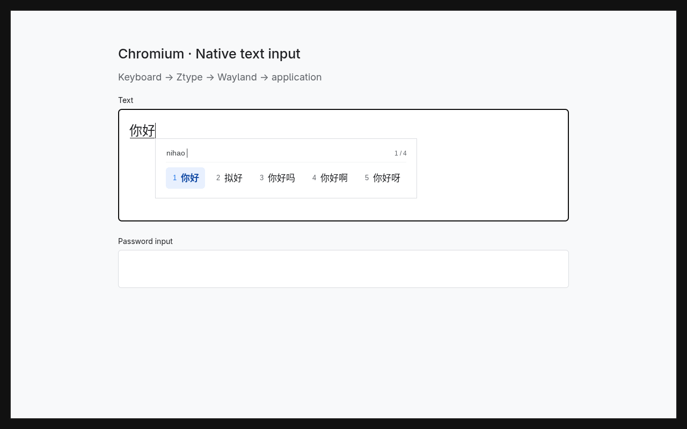
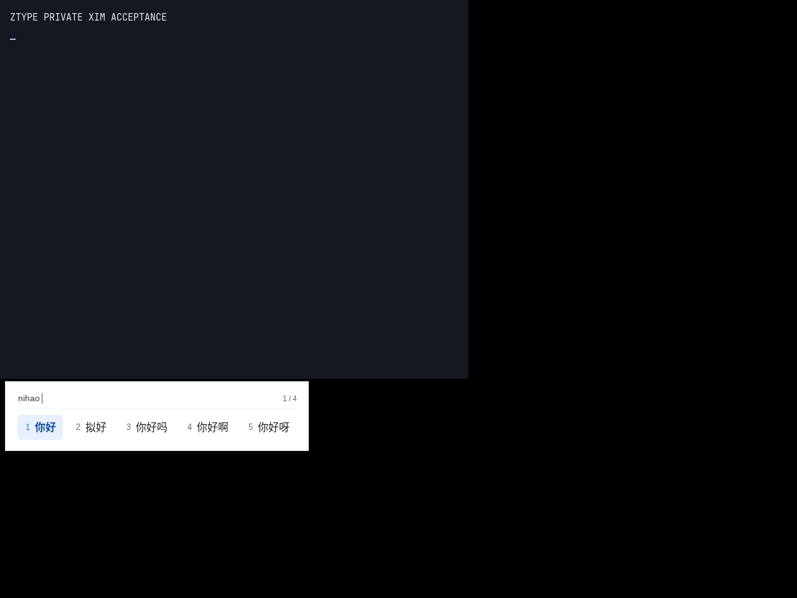

# Ztype 0.4.1 安装与验收（含已知边界）

记录日期：2026-11-20。**0.4.1 已安装，普通应用输入与 Google 风格浅色候选窗通过下表场景；GTK 只完成本地焦点切换就立即发键的测试，在第 4 轮失败，属于仍保留的已知时序边界。** 同一二进制在应用先用 `gdk_display_sync` 确认显示服务器已处理请求后，独立完成 20/20 轮。两种条件分开记录，不能据后者把前者改成通过。

安装及隔离验收期间的记录显示：相关操作未执行宿主全局切换，当时保留了 Fcitx，Ztype 两项用户服务为 inactive/disabled。交付时另有新的运行状态观测，见第 6 节。此前安装凭据与隔离验收结果继续按原时间范围解释；阶段 A（0.4.0）与阶段 B（最终 0.4.1）的证据分别保留。

## 1. 最终安装身份与变化

| 项目 | 阶段 B：最终 0.4.1 |
|---|---|
| 产品源码 | [ztype be3408ae](https://github.com/LIghtJUNction/ztype/commit/be3408aee3f9160a17821d64bf5917d0106d060b) |
| zinput 框架 gitlink | [693e904c](https://github.com/LIghtJUNction/zinput/commit/693e904ca6a662dbd7e838a2d9149ac851d4227e) |
| zgpui / 字体栅格 gitlink | [b09f3ded](https://github.com/LIghtJUNction/zgpui/commit/b09f3ded0928df5a35bad32dcd5539560b8617e6) |
| 安装路径 | `~/.local/bin/ztype` |
| 版本与大小 | `ztype 0.4.1`；1,213,672 字节 |
| SHA-256 | `7708a88b2a8b914a52abe2f10395378fb33c731621fdde9301a6679a83dc10c8` |

[最终安装 receipt](evidence/installed-native-0.4-20261120/stage-b/attempt-7708/installation-final.json) 记录了程序写入用户路径，以及安装时 Fcitx 进程被保留的事实；其中服务状态仅对应安装时点。交付时的新状态见第 6 节。依赖对应关系见 [固定源码身份](evidence/installed-native-0.4-20261120/stage-b/source-identity.json)。receipt 中的 `framework_pin_commit=108b4f8b…` 是 **ztype 仓库里更新依赖指针的提交**，实际 zinput 对象是表中的 693e904c。

0.4.1 包含两项本轮增量：

- **候选窗改为浅色、增加留白。** 白底、细浅灰边、浅蓝选中、深色文字；候选文字与编号分层。最终卡片高 112px，外留白 20px，候选间隔 8px，候选内部左右留白各 12px。这是原生输入候选窗本身的渲染变化。[固定 renderer 源码](https://github.com/LIghtJUNction/ztype/blob/be3408aee3f9160a17821d64bf5917d0106d060b/src/popup.rs)
- **补上旧键盘 grab 的焦点队列保护。** 同步后若剩余队列已有新的 activate/deactivate，丢弃旧 grab 的整批按键；只有同一字段的属性更新则保留配对按键转发。该变化来自对剩余队列的代码审查。后述首键失败发生在 IME 收到新焦点/敏感通知之前，是另一条时序，不能直接归因于这项旧 grab 保护。[框架修正](https://github.com/LIghtJUNction/zinput/commit/693e904ca6a662dbd7e838a2d9149ac851d4227e)

中间的 0.4.1 构建 `6068f541…` 尚未完成最终原生验收即被更宽松的留白版本替换；本报告的最终结论仅针对 `7708a88b…`。

## 2. 最终版本在真实应用中的结果

| 场景 | 阶段 B 实际结果 | 原始证据 |
|---|---|---|
| GTK3 原生 Wayland，Hyprland 0.57.2 | **23/23**：基本输入、候选窗、通知后的同字段重置 | [GTK 报告](evidence/installed-native-0.4-20261120/stage-b/attempt-7708/wayland/gtk-report.json) |
| Google Chrome 158.0.8127.36，原生 Wayland | **7/7**；没有专门 IME 实验开关 | [Chrome 报告](evidence/installed-native-0.4-20261120/stage-b/attempt-7708/wayland/chromium-report.json) |
| foot，真实 TTY | 接收“你好世界”，后接换行（LF） | [终端报告](evidence/installed-native-0.4-20261120/stage-b/attempt-7708/wayland/terminal-report.json) |
| 已装 Ztty 0.5.2，X11/XIM | 输入 **8/8**；独立重连 **6/6**，broker/PTY/窗口身份保持 | [输入](evidence/installed-native-0.4-20261120/stage-b/attempt-7708/ztty/typing.json) · [重连](evidence/installed-native-0.4-20261120/stage-b/attempt-7708/ztty/reconnect.json) |
| GTK 本地焦点 ACK 后立即发键 | **第 4 轮失败**，此前 3 轮通过；密码框文本为 `ihao`，preedit 为“您” | [未改写的失败报告](evidence/installed-native-0.4-20261120/stage-b/attempt-7708/wayland/focus-report.json) |
| GTK 显示服务器同步后立即发键 | **20/20 轮**，exit 0；同一程序、单独条件 | [条件及哈希记录](evidence/installed-native-0.4-20261120/stage-b/protocol-confirmed-focus/gate-summary.json) |

失败时，`n` 先进入原有 `ni` 组合，形成 `nin → 您`；IME 随后才收到 deactivate、敏感属性和 done。它证明应用内部焦点状态与另一连接上的输入事件之间仍有未确认窗口；不是对真实用户密码泄漏的观测。[带行号的协议切片](evidence/installed-native-0.4-20261120/stage-b/attempt-7708/local-focus-protocol-excerpts.json)

独立的同步门禁只在测试 receiver 的 normal/password 控制 ACK 前各加一句 `gdk_display_sync`，没有修改产品、加固定 sleep 或等待 IME 就绪。官方 API 会提交排队请求并等显示服务器处理；GTK3 Wayland 后端调用 `wl_display_roundtrip`。[GDK 文档](https://docs.gtk.org/gdk3/method.Display.sync.html) · [官方实现](https://github.com/GNOME/gtk/blob/gtk-3-24/gdk/wayland/gdkdisplay-wayland.c) · [实际补丁](evidence/installed-native-0.4-20261120/stage-b/protocol-confirmed-focus/receiver-focus-barrier.patch)

原测试报告仍带 e463 的旧“local focus”时序标签，实际 ACK 条件必须结合 gate-summary 和补丁解释。这个 20/20 结果验证的是**协议请求已确认后的条件**，没有消除此前本地 ACK 抢跑失败。



图 1：最终已装二进制的原生候选窗；浏览器页面为私有验收页面，内容为合成文本。



图 2：Ztty 当前未提供光标 spot 时使用窗口下沿回退位置。本次几何为 `x=8, y=612, 488×112`，不称作跟随终端光标。

原始阶段 B 总汇总的 `passed=false` 保持不变。正常应用子报告分别保留通过结果；完整基线外层还发生私有 document-portal FUSE 清理错误。挂载随后自行消失，验收人员只删除本任务遗留的 runtime，另存清理记录。[原汇总](evidence/installed-native-0.4-20261120/stage-b/attempt-7708/wayland/installed-acceptance-summary.json) · [有限清理](evidence/installed-native-0.4-20261120/stage-b/private-runtime-cleanup.json)

测试前后程序均为 `7708a88b…`，词库均为 `504e9f69…`；协议同步门禁的自建进程已停止。Ztty 的前、每场景后、最终四次身份记录一致。[Ztty 前后哈希](evidence/installed-native-0.4-20261120/stage-b/attempt-7708/ztty/binary-bookends.json)

框架修正的组件检查为 Wayland 15/15、Clippy、核心无默认 feature 检查；最终留白样式的现有 renderer 测试为 2/2。具体源、命令与退出状态分别见 [框架验证记录](evidence/installed-native-0.4-20261120/stage-b/build/guard-verification.json) 和 [renderer 日志](evidence/installed-native-0.4-20261120/stage-b/build/spacing-renderer-tests.log)。这些检查不被写成整个应用的一次全量 Rust 测试重跑。

### 阶段 A 保留记录

阶段 A 是 **0.4.0 / 5aa632de / SHA-256 066902ba0497f53c5ec963bb94e5deb00ade361a14d232501ab01c7d7604d5fe**：GTK/候选窗 23/23、Chrome 7/7、foot 实收“你好世界”后接换行、即时密码焦点 20/20 轮、Ztty 输入 8/8、重连 6/6。这些原始结果与深色截图留在 `stage-a/`，没有改成 0.4.1 的证据。[阶段 A Wayland 汇总](evidence/installed-native-0.4-20261120/stage-a/wayland/installed-acceptance-summary.json) · [Ztty 输入](evidence/installed-native-0.4-20261120/stage-a/ztty/typing.json) · [Ztty 重连](evidence/installed-native-0.4-20261120/stage-a/ztty/reconnect.json)

阶段 A 的两次未计入通过结论的尝试也保留原始失败状态：私有 XDG 环境最初没有可发现词库，服务在发键前退出；旧焦点测试先执行静默修改 GTK buffer 的断言，在进入密码循环前退出。随后分别以显式已装词库和分离此前置断言的测试完成验收。[缺词库尝试](evidence/installed-native-0.4-20261120/stage-a/excluded/empty-dictionary.json) · [旧前置断言](evidence/installed-native-0.4-20261120/stage-a/excluded/old-focus-precondition.json)

## 3. 工作原理与支持边界

一次拼音输入可以拆成三件具体工作：

| 层 | 做什么 | 与应用的关系 |
|---|---|---|
| zinput 核心及原生适配器 | 保存输入上下文，接收按键、焦点和敏感属性；按协议送出未确认文字或提交结果 | Wayland 走 input-method/text-input；X11 走 XIM |
| ztype | 按快捷键编辑拼音，读取词库，选择候选，管理中英文和标点设置 | 按 Space 才提交当前候选；Esc 或失效上下文会清掉尚未提交的组合 |
| zgpui-raster 与候选窗 | 把文字和选中状态绘成像素，由原生窗口展示 | 负责可见候选；不代替文本提交协议 |

例如输入 `nihao` 时，“你好”先以未确认文字（preedit）出现在控件中，候选窗展示可选项；按 Space 后，适配器通过输入协议提交文本。可见候选与最终文字进入控件是两个可独立检查的结果。核心包仍为 `zinput 0.1.3`；原生适配器和字体栅格分别是独立的适配包。[固定 Cargo 源](https://github.com/LIghtJUNction/ztype/blob/be3408aee3f9160a17821d64bf5917d0106d060b/Cargo.toml)

本机词表先按 code/text 整理、排序去重；查询以二分方式定位编码起点，**完整匹配优先**。没有整串匹配时，用动态规划寻找能覆盖整个输入的分词路径，只生成一条拼接候选，再补以前缀匹配得到的候选。排序先比较学习计数（默认关闭学习），再比较词库 priority，随后以编码长度与字典序区分；最多保留 128 个候选，默认每页 5 个。二分用于定位起点，前缀收集、筛选排序和分段搜索各有额外工作；这里没有给出全查询复杂度或性能基准结论。[固定算法源码](https://github.com/LIghtJUNction/ztype/blob/be3408aee3f9160a17821d64bf5917d0106d060b/src/engine.rs) · [候选上限](https://github.com/LIghtJUNction/ztype/blob/be3408aee3f9160a17821d64bf5917d0106d060b/src/lib.rs)

**Wayland** 需要 compositor 提供 `input-method-v2` 和 `virtual-keyboard-v1`，并由目标应用的 text-input 实现配合。本轮实测是 Hyprland 0.57.2 下的 GTK3、Chrome 和 foot，不表示任意 Wayland 桌面都可直接使用。候选窗位置由 compositor 根据输入区域定位。

**X11 / XWayland** 需要应用支持 XIM，并选择匹配的 endpoint。本轮 Ztty 测试在私有 Xvfb 的真实 X11/PTY 路径完成；没有光标 spot 时只保证窗口下沿回退位置。Windows TSF 和 macOS IMK 前端尚未实现。[最终已装功能与 help](evidence/installed-native-0.4-20261120/stage-b/installed-cli.json)

同一输入框的外部编辑，需要应用通过协议更新状态或重置输入上下文。本轮通过的是 GTK 公开光标动作触发 reset 的路径；应用仅在内部改 buffer、没有发出新状态时，输入法无法推断该变更。GTK 的 [`reset_im_context` 文档](https://docs.gtk.org/gtk3/method.Entry.reset_im_context.html) 说明了重置契约，不能扩大为“任何静默编辑都会自动取消组合”。

私有 Wayland 验收使用独立 Weston headless → Hyprland、私有 socket/会话总线，禁用物理 seat 和父窗口输入；XIM 验收使用私有 Xvfb。其 Aquamarine 0.16 测试库只对自建 Hyprland 子进程修正客户端版本协商与请求保护，系统 Hyprland/Aquamarine 没有被替换。补丁和固定库哈希的背景记录见 [原生候选 0.3 报告](native-candidates-0.3.zh-CN.md)，本轮是否使用该库由新的运行报告给出。

## 4. 词库与实际使用

本机已装 `~/.local/share/ztype/dictionaries/rime-ice.tsv`，包含 **573,194 条唯一 code/text 记录、476,748 个不同编码、15,654,275 字节**；SHA-256 为 `504e9f69e794584375bbfedef937230e5dc76faff9c7696cc9285aff64cc18d9`。记录中含 21,014 条拼音分节别名，因此不能将条数解释为同等数量的独立词语。

来源是 [Rime Ice 927e1cf1](https://github.com/iDvel/rime-ice/tree/927e1cf1d3eeb9bf4be85e3f684dba4dd485b6f6) 的 `8105.dict.yaml` 和 `base.dict.yaml`。转换合并拼音音节、保留元音起始音节前的撇号别名、对相同 code/text 取最高频率并排序。provenance 声明来源许可为 GPL-3.0；原始词表和 LICENSE 的安装副本都已核对大小与哈希。阶段 B 使用同一哈希的词库，无需重复把阶段 A 的逐条盘点宣称为新盘点。[来源与资源核对](evidence/installed-native-0.4-20261120/stage-a/installed-resources.json)

最终已装程序的配置实读为：每页 5 项、初始中文、中文标点、`enter_behavior=raw`、`learning=false`。[只读 CLI 记录](evidence/installed-native-0.4-20261120/stage-b/installed-cli.json)

| 操作 | 行为 |
|---|---|
| `nihao` 后按 Space | 提交当前候选，例如“你好” |
| 本页数字键 | 按本页编号选词，默认每页 5 项 |
| Tab / Shift+Tab、↓ / ↑ | 后一个 / 前一个候选 |
| PageDown / PageUp、`=` / `-` | 后一页 / 前一页 |
| ← / →、Home / End、Backspace / Delete | 编辑未提交的拼音 |
| Esc | 取消组合 |
| **Enter** | **默认提交原始拼音**，不是默认确认候选 |
| Ctrl+Space | 切换中英文，并取消未提交组合 |

以上数字选择针对拼音配置；码表引擎中的数字可能是编码本身。可用以下命令查看本机解析后的配置和服务状态：

```sh
~/.local/bin/ztype --version
~/.local/bin/ztype config
~/.local/bin/ztype status
```

普通应用菜单执行 `ztype start`，Linux 图形会话中无参 `ztype` 也进入服务控制；`restart` 重载服务，`stop` 停止 Ztype 服务，`try` 是显式辅助入口。旧试用菜单已先备份再移除。[菜单迁移](evidence/installed-native-0.4-20261120/stage-a/legacy-launcher-migration.json)

以下是“保留 Fcitx、另开独立 XIM 窗口”的可选使用方式，不描述当前交付状态。执行前先查看 `ztype status`；已有同名 XIM 服务运行时无需重复启动。只有在 Ztype X11 服务未运行、且希望在前台启动独立 XIM 时，才在一个终端运行：

```sh
env ZTYPE_XIM_NAME=ztype ~/.local/bin/ztype x11
```

保持该进程运行，在另一个终端新建独立 broker 的 Ztty：

```sh
env XMODIFIERS=@im=ztype ZTTY_SOCKET="@ztype-manual-$$" \
  ~/.cargo/bin/ztty --backend x11 --name ztype-manual
```

这里 `XMODIFIERS` 只传给新进程，独立 `ZTTY_SOCKET` 避免复用已经按旧环境启动的 broker；没有修改全局配置或现有窗口。结束手动方式时，关闭新 Ztty，并在前一个终端用 Ctrl+C 结束手动 XIM 进程。该操作方法需要可用的 `DISPLAY`，其 XIM 路径有私有 Xvfb 实测支持，**不代表本轮执行过宿主原位切换验收**。Wayland 服务若遇到其他输入法已占用的 seat，会报注册冲突；安装或启动 Ztype 不会自动关闭 Fcitx。

## 5. 证据与复现

证据分为 `stage-a/` 和 `stage-b/`。原始 JSON、PNG 与 PTY 记录按字节保存，不修改 `passed`。产品源码、测试脚本和二进制身份分别固定：产品 be3408；正常应用测试 cf36a0d3；即时焦点测试 e4636045，协议确认条件另加 SHA-256 为 `ee7baaa7287fb12bdbaed4011a66b97ece6823fc0a3de2a43d85be9a7bddadc6` 的两行 fixture 补丁。正式 receiver 的同契约改进随后发布为 [1313319c](https://github.com/LIghtJUNction/ztype/commit/1313319c67ac6b1368928e281d27c42a46d18dac)；实际 20 轮仍按上述 e463 加精确补丁计。阶段 B 的命令、测试源码与运行前后哈希见 [复现记录](evidence/installed-native-0.4-20261120/stage-b/reproduction.json)，阶段 A 的对应记录也保留。

旧 `target/daily-tests.log` 不构成最终源码的完整 Rust 测试重跑凭据，本报告没有移用旧日志的总数。原始报告之间有共同的启动检查和重复场景，各批计数按环境呈现，不合并为一个夸大的“总测试数”。

[manifest.json](evidence/installed-native-0.4-20261120/manifest.json) 列出文件来源、大小、SHA-256 和提取方式。在仓库根目录运行：

```sh
/usr/bin/python3 docs/evidence/installed-native-0.4-20261120/verify.py
```

可复核证据和本文的大小与哈希。完整词库、程序二进制及日常输入内容不在此小证据包中；复现时先对照本报告记录的程序与词库哈希。复跑脚本使用 `/usr/bin/python3`，避免私有 XDG 环境中的 Python shim 干扰。

## 6. 交付时运行状态补记

**只读状态快照：2026-11-20 21:56:43 +08:00；服务进程核对：21:58:10 +08:00（Asia/Taipei）。** 这些观测晚于安装及隔离验收，另存于 [交付状态记录](evidence/installed-native-0.4-20261120/stage-b/handoff-status.json)。

| 项目 | 交付检查结果 |
|---|---|
| 磁盘上的程序与词库 | 程序 SHA-256 仍为 `7708a88b…`，词库仍为 `504e9f69…` |
| `ztype-wayland.service` | active/running，PID 1605455，UnitFileState=disabled |
| `ztype-x11.service` | active/running，PID 1605456，UnitFileState=disabled |
| 两个服务的启动记录 | 2026-11-20 21:55:08 CST |
| 两个运行进程的真实文件 | `/proc/PID/exe` 均指向 `~/.local/bin/ztype`，实际文件 SHA-256 均为受测的 `7708a88b…` |
| 显示端点 | 服务环境为 `DISPLAY=:0`、`WAYLAND_DISPLAY=wayland-1`；随后读取 `XIM_SERVERS` 得到 `@server=ztype` |
| Fcitx 检查 | `pgrep -x fcitx5` 退出码 1，未检出该进程名；安装时的 PID 3568178 已不存在 |
| 观测时源码工作树 | HEAD 为 `6d095c040389dd29abf8df75c0e3875f793f36ed`，工作树 clean；该提交仅在受测产品源之后整合文档与测试 |

当前服务正在运行，但没有启用这两项用户服务的登录自启动；`disabled` 不等于未运行。现状不同于安装时，观测没有提供变化的发起者或原因。本次检查只读取进程、文件、服务状态及 XIM 注册，没有启动/停止服务，也没有向宿主窗口发键；它不构成宿主手动输入验收，也不改变前述焦点时序边界。

当前 XIM 名称已确认是 `ztype`，因此无需重复运行第 4 节的前台服务命令。要新开一个明确连接它的 Ztty，可直接使用：

```sh
env XMODIFIERS=@im=ztype ZTTY_SOCKET="@ztype-manual-$$" \
  ~/.cargo/bin/ztty --backend x11 --name ztype-manual
```

已有应用及 broker 仍可能保留启动时的输入法环境；服务活动状态不代表它们已自动迁移。已安装二进制的构建源码身份仍是 `be3408ae…`，不改写为后续的文档提交。
