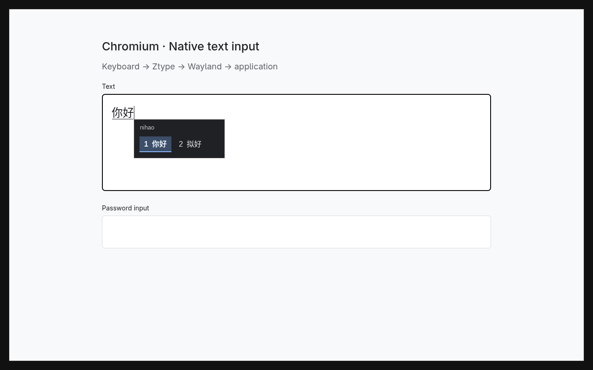

# Ztype 0.3.0：原生候选窗与 XIM 源码验收

2026-11-20。本轮在私有图形会话中的真实 GTK、Chrome、foot 和已安装的 Ztty 进程验证了候选显示、中文上屏与输入服务重连。独立 US 键盘发送 `nihao` 等 ASCII 键序，应用端核对自己的文本或 PTY 字节。

**本页记录固定源码的验收。形成记录时宿主仍由 Fcitx 处理输入；默认安装升级与服务切换另行记录。** 验证输入均为合成样例，词库覆盖和日常使用配置不由这些场景推断。



图中是私有验收页面：Chrome 的原生 textarea 显示“你好”预编辑，候选窗包含编码与两项候选。该页面用于核对真实输入协议和绘制结果。

## 1. 固定源码与二进制

| 对象 | 固定提交 |
| --- | --- |
| 产品源码 | [ztype 45a8c3e](https://github.com/LIghtJUNction/ztype/commit/45a8c3ee30341fb95582838735aeb9dc9f2e2e60) |
| 复现脚本 | [ztype b5b9c8f](https://github.com/LIghtJUNction/ztype/commit/b5b9c8f7b558249ddbdbaeb800b9c9f43432d005)，相对产品提交只改脚本和接收端 fixture |
| 原生输入框架 | [zinput f5d15e0](https://github.com/LIghtJUNction/zinput/commit/f5d15e07d7ed233539e1cad87cfc0edb787bf34e) |
| 无窗口字体与像素绘制 | [zgpui b09f3de](https://github.com/LIghtJUNction/zgpui/commit/b09f3ded0928df5a35bad32dcd5539560b8617e6) |

Wayland 各批次使用冻结二进制 `b1d23f50…`；最终 XIM 验收使用 `d965b972…`。前者的框架 pin 是 `4644099`，到 `f5d15e0` 仅改变 XIM 失败清理和相关测试/文档；两者的 native/wayland Git tree 均为 `fe28956fc23ff22efe10a339e937c0ba6c4d9906`。保留两个不同二进制身份，不把前构建的 Wayland 结果描述成后构建的完整重跑。完整 SHA-256、差异路径和来源见 [source-identity.json](evidence/native-candidates-20261120/source-identity.json)。

## 2. 实际结果

| 范围 | 结果与证据 |
| --- | --- |
| Rust、构建与 feature 组合 | [51 项 Rust 测试](evidence/native-candidates-20261120/build/tests.log)通过；Clippy、release、无默认 feature 的 CLI、仅 Wayland 检查通过，见 [构建记录](evidence/native-candidates-20261120/build/report.json)和[组合记录](evidence/native-candidates-20261120/build/accepted-build.json) |
| GTK3 / Hyprland 0.57.2 基础输入 | 14 项通过：预编辑、确认、退格、取消、词组、Tab/数字选词、密码直通、焦点变化、快捷键、中英切换与只读字段 |
| Wayland 候选窗 | 同一批另有 8 项通过：真实显示且不抢焦点，换选/确认/取消/删空后隐藏，以及密码、只读、窗口切换后的清理；见 [attempt-3 原始报告](evidence/native-candidates-20261120/wayland/gtk-attempt-3.json) |
| 同输入框的外部编辑通知 | 后续单独通过 1 个新增门禁，另含重复的接收端启动检查，见 [通知复验](evidence/native-candidates-20261120/wayland/gtk-external-notified.json) |
| Chrome 158.0.8127.36 | 原生 Wayland、默认 IME 选项，7/7：组合、中文确认、应用换行、非首候选、英文模式、取消、密码直通；[独立子报告](evidence/native-candidates-20261120/wayland/chrome.json)记录 explicit_ime_flags=false |
| foot | 真正的终端 stdin 为 TTY，收到 `你好世界\n`，UTF-8 十六进制为 `e4bda0e5a5bde4b896e7958c0a`；见 [stdin 证据](evidence/native-candidates-20261120/wayland/foot.json) |
| Ztty 0.5.2 / XIM | 私有 Xvfb 中 8/8：候选显示、确认、第二候选、取消、英文切换及退格；[键入报告](evidence/native-candidates-20261120/x11/typing.json)包含实际 PTY 字节 |
| 已打开 Ztty 的服务重连 | 独立复验 6/6：服务出现、停止、重启前后终端仍可用，window、broker PID、PTY PID 在四阶段保持相同；[隔离重连报告](evidence/native-candidates-20261120/x11/reconnect-isolated.json)记录临时 XDG 与受控 ZTYPE 子环境 |

GTK 的 23 个不重复门禁来自 **14 + 8 + 1 的分批证据**。attempt-3 在随后 raw 编辑场景失败，原始 `passed=false` 完整保留。Chrome 的 7 项来自独立子报告；apps-1 总报告还包含可选 terminal helper 的 `NameError`，仍为 false。foot 采用 external-trace-1 的成功子报告。各批次状态与冻结 hash 见 [sessions.json](evidence/native-candidates-20261120/wayland/sessions.json)，不合并改写原始总状态。


Ztty 本轮使用窗口底边 fallback 放置候选窗，未证明跟随终端字符光标。重连试验仅在私有 DISPLAY 内显式选择 `fcitx` 这个 XIM 名字，用于验证既有终端发现和重连同名服务；宿主输入服务未参与。

## 3. 外部编辑：区分内存变化与协议通知

第一次 raw `set_text("application-edit")` 改变了 GTK buffer，但保留“你好”预编辑。本次观测区间内，客户端没有发送新的 text-input 请求，IME 也没有收到对应状态更新，因此该路径的自动取消没有通过；[边界摘录](evidence/native-candidates-20261120/wayland/raw-edit-boundary.json)保留失败状态、日志区间和零请求计数。

[GTK 官方 reset_im_context 文档](https://docs.gtk.org/gtk3/method.Entry.reset_im_context.html)说明，修改 buffer 可能需要重置输入上下文。[text-input-v3 协议](https://gitlab.freedesktop.org/wayland/wayland-protocols/-/blob/main/unstable/text-input/text-input-unstable-v3.xml)用变更原因区分输入法自身与其他来源；状态随 commit 生效。[input-method-v2 协议](https://github.com/swaywm/wlroots/blob/master/protocol/input-method-unstable-v2.xml)将相关事件应用于下一次 done。

复验通过公开 GtkEntry `move-cursor BUFFER_ENDS` 动作触发 reset 通知，未直接构造发给 IME 的协议消息：

| 日志时刻 | 实际事件 |
| --- | --- |
| 12:11:23.932 | GTK 发送 surrounding_text(`application-edit`,16,16)、cause=1（OTHER）与 commit |
| 12:11:23.936 | IME 收到对应状态和 done，发出空 preedit 与 commit(6) |
| 随后 | 候选窗 hidden、generation=3；再输入 shijie 后得到 `application-edit世界`，没有增加焦点切换 |

见 [双方协议摘录](evidence/native-candidates-20261120/wayland/notified-edit-trace.txt)。这些时刻用于关联事件，不是延迟基准。结论限于本次公开 GTK 通知路径；raw buffer 修改没有被改记为通过。

显示判定同时使用真实截图、应用焦点和最终文本；诊断字段 `presented` 仅表示绘制请求已提交。此次采集的 25 条 popup 状态样本为 13 条 presented、12 条 hidden，没有 queued；不能据此单独宣称真实 buffer 饱和分支已被覆盖。密码直通的证据限本轮 GTK/Chrome 的 Wayland 字段；XIM 验证范围是终端输入和重连。

## 4. 隔离环境与复现入口

Wayland 会话由 Weston 15.0.1 headless + GL 父环境承载独立 Hyprland 0.57.2，使用私有 socket/DBus，关闭物理 seat 与父环境键鼠输入。接收端、浏览器和键盘均为本次创建的测试进程；Wayland 会话记录确认这些进程已退出。

测试链需要私有 Aquamarine 0.16.0 客户端修正：bind 取 advertised/supported 的较小版本，并检查实际请求所需的最低版本；生成的 wl_shm v1 析构也避免发送 v2 release。它只通过子 Hyprland 的 LD_LIBRARY_PATH 生效。系统 Hyprland/Aquamarine 文件的前后 SHA-256 相同；[元数据](evidence/native-candidates-20261120/aquamarine/build-metadata.json)、[补丁与构建步骤](evidence/native-candidates-20261120/aquamarine/README.txt)随附。

在独立检出选择上述脚本提交，初始化子模块。构建使用 Rust 1.100 与各原生前端 README 所列系统开发依赖；构建目录放在 /var/tmp：

```sh
git checkout --detach b5b9c8f7b558249ddbdbaeb800b9c9f43432d005
git submodule update --init --recursive
export CARGO_TARGET_DIR=/var/tmp/ztype-0.3-replay-build
cargo test --locked --all-targets
cargo clippy --locked --all-targets -- -D warnings
cargo build --locked --release
cargo check --locked --no-default-features
cargo check --locked --no-default-features --features wayland
```

复跑时使用新的输出目录。设置 ZTYPE_REPLAY_BINARY 为刚构建的可执行文件，ZTYPE_REPLAY_AQ 为上述私有库目录；测试程序不会要求切换宿主输入服务。

```sh
/usr/bin/python3 scripts/test_wayland_nested.py --binary "$ZTYPE_REPLAY_BINARY" \
  --headless --aquamarine-library "$ZTYPE_REPLAY_AQ" --popup --screenshot \
  --output /var/tmp/ztype-0.3-replay-gtk

/usr/bin/python3 scripts/test_wayland_nested.py --binary "$ZTYPE_REPLAY_BINARY" \
  --headless --aquamarine-library "$ZTYPE_REPLAY_AQ" --skip-gtk --chromium \
  --output /var/tmp/ztype-0.3-replay-chrome

xvfb-run -a -s "-screen 0 1280x800x24 -nolisten tcp" \
  env ZTYPE_XIM_TEST_PRIVATE=1 /usr/bin/python3 scripts/test_xim_ztty.py \
  --ztype "$ZTYPE_REPLAY_BINARY" --ztty "$(command -v ztty)" \
  --scenario reconnect --output-dir /var/tmp/ztype-0.3-replay-xim
```

通知边界可在第一条追加 `--external-edit-only --protocol-trace` 单独复现；foot 使用 `--skip-gtk --terminal`，XIM 键入场景使用 `--scenario typing`。这些是复跑入口；已发生的分批结果以上表及原始 JSON 为准。

## 5. 证据清单与依赖传播

[manifest.json](evidence/native-candidates-20261120/manifest.json)记录每份复制文件和派生摘录的来源、SHA-256、字节数及提取方式；[summary.json](evidence/native-candidates-20261120/summary.json)提供机器可读结论。证据只包含合成测试内容、小截图、构建记录和必要协议片段。

依赖传播见 [Project Z 候选 1b1b6b2](https://github.com/LIghtJUNction/project-z/blob/1b1b6b2f13a4a2f1d9ced88a13b14ac93118a12c/docs/reports/native-input-cohort-20261120/README.md)：43 仓库、65 包已登记，五个消费者协调提交已推送。完整 check/resolve 仍被唯一的 zmcl vendor/zgpui 指针阻塞，最小补丁交其现有 main 写入者；该聚合候选尚未接受或合入 main。
